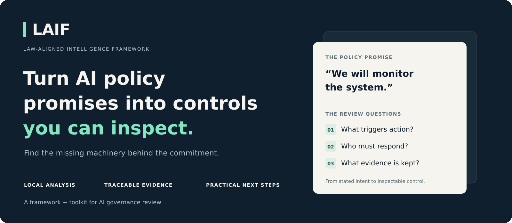
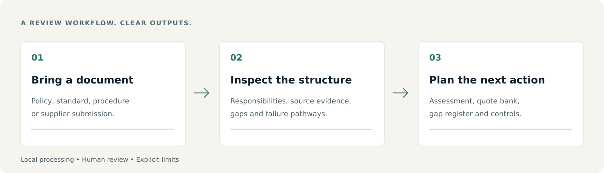

<p align="center">
  
</p>

<p align="center">
  <strong>Law-Aligned Intelligence Framework</strong><br>
  A model-independent framework and local toolkit for reviewing AI governance documents.
</p>

<p align="center">
  <a href="#try-it-locally">Try it locally</a> ·
  <a href="docs/examples/sample-assessment.md">Read a sample assessment</a> ·
  <a href="LAIF_Executive_Brief.txt">Read the executive brief</a> ·
  <a href="docs/GETTING_STARTED.md">Getting started</a>
</p>

<p align="center"><strong>Local execution</strong> &nbsp; / &nbsp; <strong>No model API key</strong> &nbsp; / &nbsp; <strong>Standard-library core</strong> &nbsp; / &nbsp; <strong>Markdown + JSON outputs</strong></p>

## Good principles need working machinery

“Responsible AI.” “Human oversight.” “Accountability.”

Those commitments matter. The practical question is what happens next: **who acts, what triggers action, what evidence is kept, and how a harmful decision can be corrected.**

LAIF is a **structural governance integrity framework** for AI-related institutional documents. Its Python toolkit examines policies, standards, supplier submissions and operational procedures, then produces source-linked findings and practical control recommendations for a human reviewer.

Use it to make a policy review more concrete, prepare better supplier questions, or identify what needs to be demonstrated before a release. External documents can express safeguards in their own language; they do not have to adopt LAIF terminology to receive a diagnostic assessment.

## From a document to a review you can act on



| You bring | LAIF helps you examine | You take away |
|---|---|---|
| An AI policy or operating standard | Responsibilities, oversight, escalation, review and reversibility | An assessment with quoted evidence and identified gaps |
| A procurement document or supplier response | Obligations, evidence requests, accountability and unresolved controls | Questions and control recommendations for due diligence |
| A deployment or release procedure | Approval, incident handling, monitoring and change control | A structured starting point for readiness review |
| Several governance documents | Recurring gaps and differences in the assessed corpus | A batch portfolio and prioritised review roadmap |

**A concrete example.** The included [synthetic supplier policy](docs/examples/vendor-policy.md) promises monitoring and review, but leaves out monitoring thresholds, consequences for non-compliance and lifecycle change controls. Its [actual generated assessment](docs/examples/sample-assessment.md) identifies those gaps and recommends the missing control artefacts. It also identifies protections that the document already expresses. This is an illustration, not a customer result or a measured effectiveness claim.

## Try it locally

You need Git and Python 3. The published independent verification was executed on Python 3.12; the repository targets Python 3.10. Text and Markdown processing need no third-party packages or model API key.

```bash
git clone https://github.com/mick353/LAIF.git
cd LAIF
python3 scripts/laif_process_document.py docs/examples/vendor-policy.md --extractor builtin
```

Open `laif_outputs/vendor-policy.institutional_report.md` first. The same run also writes a technical appendix, Markdown and JSON assessment data, and an analyst bundle containing the quote bank, governance gap register, failure pathways and control recommendations.

To review your own document:

```bash
python3 scripts/laif_process_document.py /path/to/your-policy.md --extractor builtin
```

To print the assessment without creating outputs:

```bash
python3 scripts/laif_process_document.py docs/examples/vendor-policy.md --extractor builtin --no-write --print-report
```

On Windows, use your Python launcher (for example, `py -3`) in place of `python3`. Windows execution is not covered by the published independent verification. Word and PDF extraction use optional local packages; see the [format and setup guide](docs/GETTING_STARTED.md). Keep private source documents and generated assessments out of this public repository.

## What you get

- **An institutional assessment:** a readable executive finding, strengths, gaps and suggested next actions.
- **Traceable evidence:** source identity, SHA-256, source quotations and locations for review.
- **A governance gap register:** missing control machinery, affected interests and recommended control artefacts.
- **Failure pathways:** structured explanations of how a documented commitment might fail to control a real decision.
- **Control recommendations:** practical additions to review, adopt or reject in context.
- **An analyst bundle:** Markdown and JSON for further work by a person or an AI assistant of your choice. LAIF does not call a model API to generate these outputs.
- **Batch processing:** per-document outputs and a portfolio summary through the [local batch runner](docs/governance/DOCUMENT_PROCESSING_RUNNER.md).
- **Optional evidence checks:** hashes, exact quotes, positive/negative test records, contradictions and duplicate identities. [Evidence diagnostic guide →](docs/governance/EVIDENCE_CHECKS.md)

[Explore the generated sample](docs/examples/README.md) · [Browse the corpus assessment](reports/laif_real_world_assessment.md) · [Read the one-page summary](reports/laif_executive_summary.md)

## Built for the people who have to ask the next question

**Governance and assurance teams** can turn general commitments into review questions and evidence requests. **Procurement teams** can scrutinise supplier claims and contractual controls. **Test and release managers** can examine whether approval, monitoring, incident and rollback arrangements are actually specified. **Policy teams and researchers** can apply a consistent structural lens while retaining source quotations and transparent limits.

LAIF includes diagnostic sector profiles for government services, departmental AI development, procurement, clinical AI, employment, education, financial services and general AI governance. Automatic document and sector classification is heuristic: reviewers should check it against the source and select a sector explicitly where needed.

## The framework behind the toolkit

The primary instrument is the **Pre-Deployment Coherence Assessment (PDCA)**. Its **Coherence Test** asks:

1. **Coupling:** does a restriction identify and protect the specific human interest at risk?
2. **Consistency:** would the same reasoning work across comparable actors and scales?
3. **Reversibility:** can future actors revise the arrangement and correct its consequences?

The **Integrity Layer** adds Structural Transparency, Structural Honesty and Structural Containment: explain the basis of outputs, align stated and implemented objectives, and stay within authorised boundaries. **Self-Application** extends scrutiny to governance actors themselves.

These are LAIF's assessment criteria. Document analysis can identify how protections are expressed; operational evidence and human judgement are needed to establish whether they work in practice.

| Assessment mode | What the result means |
|---|---|
| **External framework diagnostic assessment** | A model-relative assessment of the source document in its own vocabulary; diagnostic, not certification. |
| **LAIF-native certification** | A strict internal PASS/FAIL channel for documents that explicitly claim or seek LAIF adoption. It is not external accreditation. |
| **Remediation / patch guidance** | Suggested clauses, controls and evidence for a reviewer to consider. |
| **Repository governance / local verification** | Software checks covering provenance, regressions and protected artefacts. A software pass is not governance certification. |

## Inspect the evidence behind the software

The [independent offline verification record](docs/verification/2026-10-23/README.md) includes actual execution logs, negative controls and reproducibility checks. The corrected version passed the full local gate with network access blocked, including a fresh environment without optional packages. That is evidence about software operation, not proof of institutional control effectiveness.

Run a targeted check:

```bash
python3 scripts/laif_verify.py
```

Run the complete local gate:

```bash
python3 scripts/laif_verify.py --full --base-ref origin/main
```

GitHub Actions is not required. For a merged change, use its pre-merge base SHA rather than unchanged `origin/main`: a change-sensitive check over an empty diff does not demonstrate protection. [Verification details and remaining source/runtime gaps →](docs/verification/2026-10-23/README.md)

## Understand the boundaries

LAIF **does not determine legal validity** or legal enforceability. It **does not claim authority over external jurisdictions**, regulators or institutions, and **does not require external frameworks to use LAIF vocabulary** for diagnostic assessment. A **not LAIF-native** result does not mean legally invalid, unsafe or worthless.

Scores are **deterministic rubric outputs**, not statistical confidence levels, regulatory ratings or independent certification. A supplied log, matching hash or `REVIEW_READY` status does not prove truthful execution or a working production control. Reviewers must examine source context, classification, supporting artefacts and counter-evidence.

The toolkit is currently a local Python command-line workflow with generated reports. It does not provide a hosted service, graphical application or live deployment monitoring.

## Explore further

| Start here | Go deeper |
|---|---|
| [Getting started](docs/GETTING_STARTED.md) | [Document processing guide](docs/governance/DOCUMENT_PROCESSING_RUNNER.md) |
| [Executive brief](LAIF_Executive_Brief.txt) | [Core framework v1.2](LAIF_v1.2.txt) |
| [Public introduction](LAIF_Public_Article.txt) | [Compliance Toolkit v1.1](LAIF_Compliance_Toolkit.txt) |
| [Worked synthetic example](docs/examples/README.md) | [Technical reference and repository map](docs/product/REFERENCE.md) |
| [Current corpus assessment](reports/laif_real_world_assessment.md) | [Source provenance manifest](corpus_manifest.md) |
| [Contribution guide](CONTRIBUTING.md) | [Score interpretation](docs/governance/SCORE_INTERPRETATION.md) |

**Questions or feedback?** [Open an issue](https://github.com/mick353/LAIF/issues/new) with your use case, command, Python version and a sanitised example. Do not upload confidential policies or operational logs. Maintained by [Michael Robinson](https://github.com/mick353).

**Licensing:** this repository does not currently include a distribution licence. Ask the maintainer about redistribution and commercial reuse; public availability does not itself grant those permissions.

---

LAIF v1.2 · Compliance Toolkit v1.1 · October 2026
